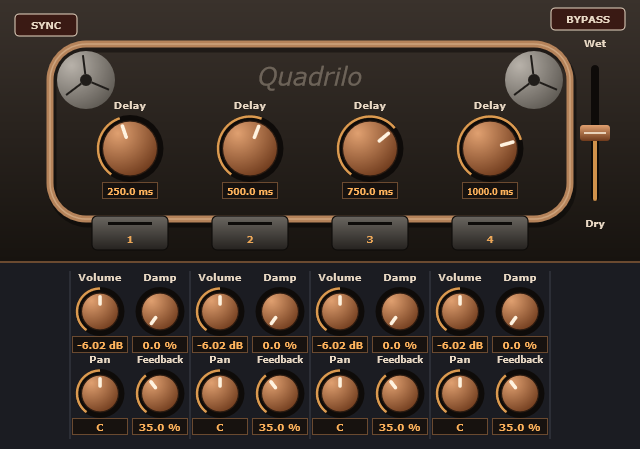

# Quadrilo

Quadrilo is a four-tap stereo delay plugin (VST3 and standalone) built with [JUCE](https://juce.com).
Four independent delay taps share a stereo input. Each tap has its own delay time, feedback,
damping filter, volume and pan, and the delay times can be locked to the host tempo.



## Features

- Four delay taps, each with its own Delay, Volume, Damp, Pan and Feedback controls
- Tempo sync: each tap's delay time becomes one of 14 note values (1/32 up to 1/1, including dotted and triplet notes)
- Wet/Dry mix and bypass
- Per-tap one-pole low-pass ("Damp") in the feedback path for darker repeats
- Smoothed parameter changes and interpolated delay reads for click-free automation
- All controls are automatable and saved with the host project

## Controls

| Control | Per tap | Description |
|---|---|---|
| Delay | yes | Delay time, 1 ms to 2000 ms. With Sync on, replaced by a note-value selector. |
| Volume | yes | Level of the tap's output, shown in dB (default -6.02 dB). |
| Damp | yes | Low-pass amount applied to each repeat. 0 % is bright, higher values are darker. |
| Pan | yes | Position of the tap in the stereo field (L 100 ... C ... R 100). |
| Feedback | yes | How much of the tap is fed back into its own delay line (0 to 99 %). |
| Sync | no | Locks all delay times to the host tempo (falls back to 120 BPM without a host tempo). |
| Wet/Dry | no | Crossfade between the dry input (bottom) and the delay taps (top). |
| Bypass | no | Smoothly fades the delay taps out, leaving the dry input. |

## Building

Requirements: CMake 3.22 or newer and a C++20 compiler (developed with Visual Studio on Windows).

```powershell
git clone <repository-url>
cd quadrilo-juce
cmake -S . -B build -G "Visual Studio 17 2022" -A x64
cmake --build build --config Release --target Quadrilo_VST3 Quadrilo_Standalone
```

Adjust the generator name to match your installed Visual Studio version. JUCE 8.0.4 is fetched at configure time with
CMake FetchContent, so the first configure needs network access.

Build output:

- VST3: `build/Quadrilo_artefacts/Release/VST3/Quadrilo.vst3`
- Standalone: `build/Quadrilo_artefacts/Release/Standalone/Quadrilo.exe`

To use the VST3, copy the `Quadrilo.vst3` folder to `C:\Program Files\Common Files\VST3`.

Run the delay engine tests (they need no plugin host) with:

```powershell
cmake --build build --config Release --target QuadriloDspTests
ctest --test-dir build -C Release --output-on-failure
```

GitHub Actions builds every push. Pushing a `v*` tag creates a release with a
zip of the VST3, the standalone app and all licence files.

## Status

Quadrilo is an early version (0.1.0). It has so far been built and run on Windows only.

## Licence

Quadrilo is free software: you can redistribute it and/or modify it under the
terms of the GNU General Public License as published by the Free Software
Foundation, either version 3 of the License, or (at your option) any later
version. See [`LICENSE`](LICENSE).

Quadrilo uses JUCE under the AGPLv3. See [`NOTICE.md`](NOTICE.md) for all
copyright notices and third-party licences.

## Credits

Designed and developed by [duddex](https://github.com/duddex), with the help of the
[OpenCode](https://opencode.ai) coding harness and Anthropic's Claude Sonnet 5.5.
Built on the [JUCE](https://juce.com) framework.
